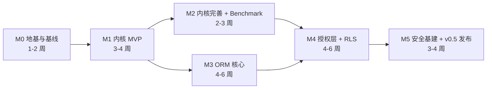

# Leant 开发计划 v0.1

> 对应 [PRD.md](./PRD.md)。按单人或小团队估算，单位为周，可并行的任务会注明。

## 总览



总计约 **17–25 周**到 v0.5（功能达到 PRD 的 P0 加主要 P1）。

---

## 仓库结构（规划）

```
leant/
├── lean-toolchain            # 固定版本（≥ v4.30）
├── lakefile.lean
├── Leant.lean                # 总入口
├── Leant/
│   ├── Core/                 # Context, Handler, Middleware, AppError
│   ├── Router/               # Radix tree, Group, 路由 DSL
│   ├── Transport/            # Std.Http 适配层（可替换）
│   ├── Binding/              # JSON / query / form 绑定，精化类型校验
│   ├── Middleware/           # Logger, Recovery, CORS, RequestID, Timeout ...
│   ├── Testing/              # 内存 Request → Response 测试工具
│   ├── Data/                 # ORM：Driver, Pool, Model, Query AST, SQL 渲染, Migration
│   │   └── Sqlite/ Postgres/
│   ├── Authz/                # Principal, Policy, evaluate, guard, 定理
│   └── Security/             # Session, CSRF, RateLimit, Crypto FFI
├── LeantTest/                # 单元与集成测试
├── examples/
│   ├── hello/  todo/  saas/
└── bench/
    ├── leant/                # TFB 规范实现
    ├── baselines/{gin,axum,django}/
    ├── scripts/run.sh        # wrk / wrk2 / oha 驱动
    └── results/              # CSV + 生成的报告
```

---

## M0：地基与性能基线（1–2 周）

**目标**：确认 `Std.Http` 能用，并测出它的原始性能，作为后面所有决策的依据。

| # | 任务 | 产出 |
|---|---|---|
| 0.1 | 安装 elan，固定 `lean-toolchain`，初始化 `lakefile.lean` | 能 `lake build` |
| 0.2 | 配 CI（GitHub Actions）：build、test、禁止 `sorry` 的检查 | `.github/workflows/ci.yml` |
| 0.3 | 用裸 `Std.Http` 写 `/plaintext` 和 `/json` | `bench/raw-std-http` |
| 0.4 | 写 Gin 基线（同样两个端点） | `bench/baselines/gin` |
| 0.5 | 编写压测脚本（wrk 和 oha，并发梯度，CPU 绑核，结果输出 CSV） | `bench/scripts/run.sh` |
| 0.6 | **基线报告**：`Std.Http` 对比 Gin | `bench/results/M0.md` |

**决策点 D0**：如果 `Std.Http` 只能达到 Gin 的 10% 以下，或者在高并发下不稳定，就启用备选方案：在 `Transport` 层后面接 Rust（hyper）或 C shim，Lean 只负责路由和业务（类似 Lithe）。

---

## M1：Gin 风格内核 MVP（3–4 周）

| # | 任务 | 对应 PRD |
|---|---|---|
| 1.1 | `Transport` 抽象层和 `Std.Http` 适配器 | K1 |
| 1.2 | `Context`：param、query、header、cookie、body 读取，响应构造，按请求的 KV 存储 | K5, K7 |
| 1.3 | Radix tree 路由：静态、`:param`、`*wildcard`、按方法分发、404/405 | K2 |
| 1.4 | `Group` 和中间件链（`next`/`abort`） | K3, K4 |
| 1.5 | `AppError` 和统一错误响应 | K9 |
| 1.6 | JSON 绑定，以及精化类型校验工具（`Bounded`、`NonEmpty`、`Email`） | K6 |
| 1.7 | 内置中间件：Logger、Recovery、RequestID、CORS、BodyLimit | K8 |
| 1.8 | 内存测试工具 `Leant.Testing.run app req` | K11 |
| 1.9 | 示例 `examples/hello`、`examples/todo`（内存存储） | — |

**目标 API 草图**：

```lean
import Leant
open Leant

def main : IO Unit := do
  let app := Leant.default            -- 默认带 Logger + Recovery
    |>.get "/ping" (fun c => c.text "pong")
    |>.group "/api/v1" (·
      |>.use requestId
      |>.get  "/users/:id" getUser
      |>.post "/users"     createUser)
  app.run ":8080"

def getUser (c : Context) : HandlerM Response := do
  let id ← c.param! "id" (α := Nat)    -- 解析失败直接返回 400
  c.json (← findUser id)
```

**验收**：示例能跑通；`LeantTest` 覆盖路由、中间件和绑定；不出现 `sorry`。

---

## M2：内核完善、首批证明、Benchmark 体系（2–3 周，可与 M3 并行）

| # | 任务 |
|---|---|
| 2.1 | **路由定理**：`lookup` 是全函数；静态路由优先于参数路由；`lookup (render r ps) = some (r, ps)` |
| 2.2 | 路由 DSL 宏（编译期检查 path 参数与 handler 签名一致） |
| 2.3 | 超时、优雅停机、连接数上限的配置项 |
| 2.4 | 流式响应和 SSE |
| 2.5 | 实现 `bench/leant`：TFB 的 plaintext 和 JSON 端点 |
| 2.6 | 基线补充 Axum、Django；生成对比报告 |
| 2.7 | CI 冒烟压测，回退超过 10% 时告警 |
| 2.8 | 性能剖析（`perf`），优化热路径（Header 解析、路由、JSON 编码） |

**里程碑 = MVP 发布 v0.1**：吞吐 ≥ Gin 的 30%。

---

## M3：ORM 核心（4–6 周）

| # | 任务 | 对应 PRD |
|---|---|---|
| 3.1 | `Driver` 类型类；接入 `leansqlite` | O1 |
| 3.2 | 连接池 | O2 |
| 3.3 | `Column α`、`Table` 的类型设计；`FromRow`/`ToRow` | O3 |
| 3.4 | `model` 宏：从 `structure` 生成表元数据和行编解码 | O3 |
| 3.5 | 查询 AST（select/where/orderBy/limit/join），类型安全的表达式 | O4 |
| 3.6 | SQL 渲染器（只生成参数化 SQL）；**定理：用户值只出现在参数列表** | O5 |
| 3.7 | insert/update/delete、事务 | O6 |
| 3.8 | Benchmark：TFB 的 db、queries、fortunes、updates | — |
| 3.9 | 示例 `todo` 换成 SQLite 存储 | — |

**目标 API 草图**：

```lean
model Post where
  id       : PrimaryKey Nat
  tenantId : TenantKey Nat          -- 标记为租户列，M4 用于自动 RLS
  authorId : Nat
  title    : Bounded String 200
  body     : String

let posts ← db.run <| Post.query
  |>.where (fun p => p.authorId == uid && p.title.like "%lean%")
  |>.orderBy (·.id) .desc
  |>.limit 20
```

**决策点 D3**：Postgres 用 libpq 自己写 FFI，还是依赖 `linen` 或 `lean-pq`。在 M3 末评估维护活跃度和许可证后决定。

---

## M4：授权层与 RLS（4–6 周）⭐ 核心差异化

| # | 任务 | 对应 PRD |
|---|---|---|
| 4.1 | `Principal`、`Action`、`Resource`、`Decision` 类型 | A2 |
| 4.2 | 策略语言 v1（RBAC 加 owner 规则加租户），`evaluate` 纯函数 | A3 |
| 4.3 | `guard` 和 `Authorized p a r` 证明令牌，handler 签名要求这个证明 | A4 |
| 4.4 | 认证中间件：JWT 或 Session 解析成 `Principal`（先做一种） | A1 |
| 4.5 | `requires .delete on post` 语法宏 | A5 |
| 4.6 | **定理**：默认拒绝、deny 优先、租户隔离、单调性、角色授予不越权 | A6 |
| 4.7 | ORM 的 RLS 注入：租户模型的查询自动加谓词，**定理：WHERE 蕴含租户条件** | O8 |
| 4.8 | `/authz/:id` 基准，量化安全层开销 | — |
| 4.9 | 示例 `examples/saas`（多租户 + 角色），附"证明了什么"文档 | — |

---

## M5：安全基建与 v0.5 发布（3–4 周）

| # | 任务 |
|---|---|
| 5.1 | Crypto FFI（OpenSSL）：HMAC-SHA256、SecureRandom、常量时间比较 |
| 5.2 | 签名 Session、安全 Cookie 默认值、CSRF 中间件 |
| 5.3 | 密码哈希（argon2） |
| 5.4 | 令牌桶限流 |
| 5.5 | 迁移工具（模型 diff，版本表，up/down） |
| 5.6 | Postgres 驱动 |
| 5.7 | 文档站：Quick Start、指南、API 参考、TCB 和已证明性质清单 |
| 5.8 | 72 小时稳定性压测，发布 v0.5 |

---

## 横向工作（贯穿全程）

- **规范**：核心代码禁止 `sorry`；`partial` 和 `unsafe` 必须登记到 `docs/UNSAFE.md` 并说明理由。
- **测试**：每个模块对应一个 `LeantTest/` 文件；集成测试用真实 socket。
- **工具链**：每个季度评估 Lean 升级，升级必须通过全部测试和压测。
- **决策记录**：重要设计决策写成 ADR，放在 `docs/adr/NNN-*.md`。

## 下一步（本周就能开始）

1. 完成 M0.1–0.2：初始化 Lake 项目和 CI。
2. 完成 M0.3–0.6：裸 `Std.Http` 对比 Gin 的基线报告，这是整个架构的第一个决策点。
